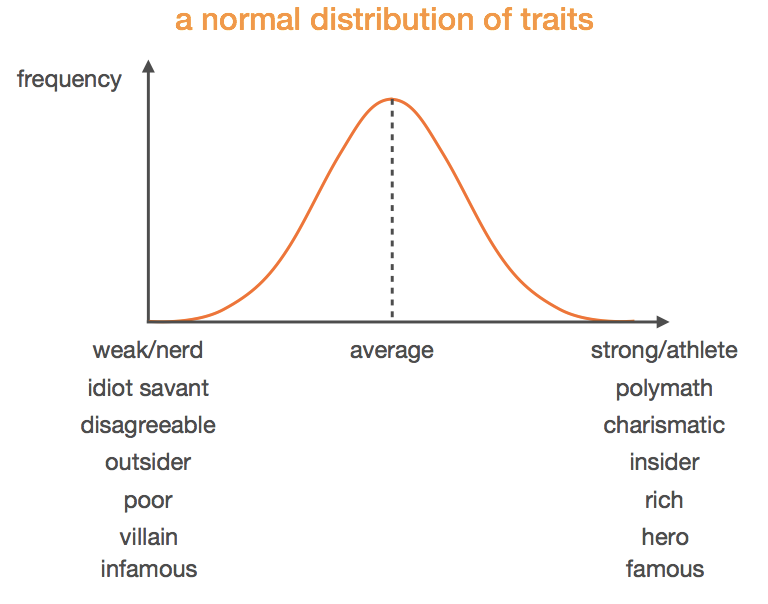
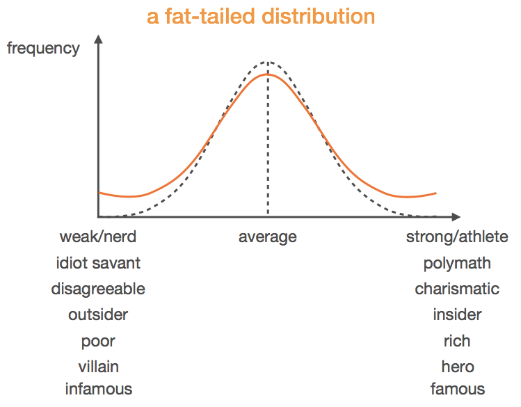
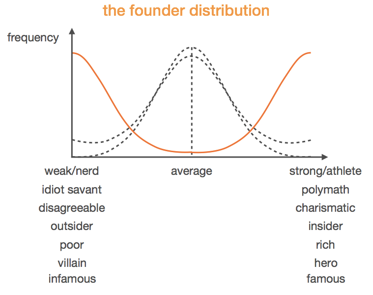
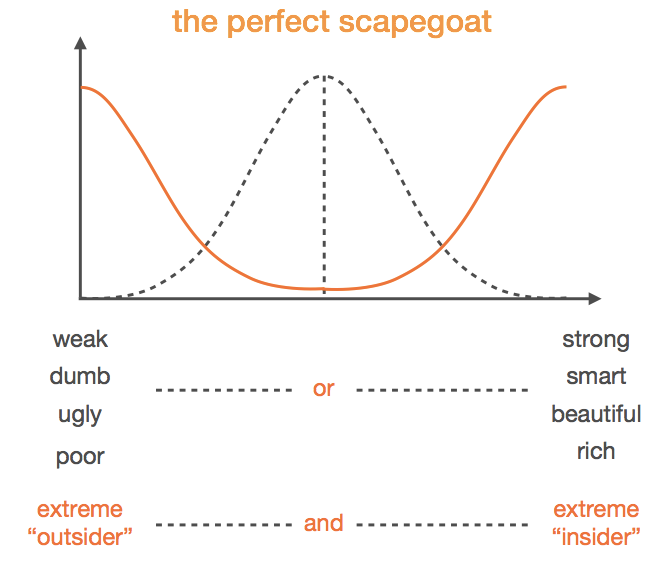
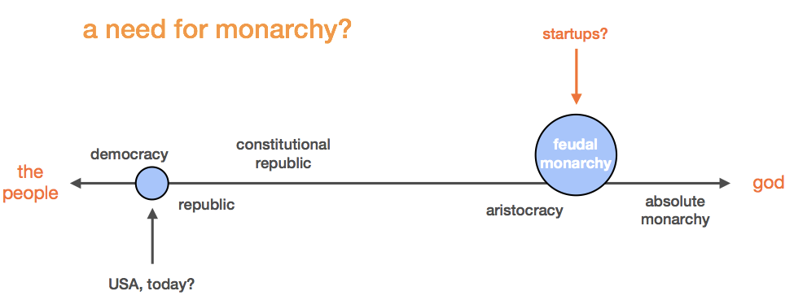
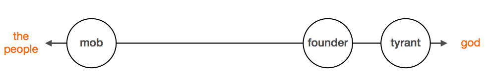

<a href="/dissertation">Contents</a> · <a href="https://summit.sfu.ca/item/39969" rel="noopener">Official record (SFU Summit)</a>

<h1 class="diss-chapter">Chapter 5. René Girard's neoliberal politics of envy</h1>

The French polymath René Girard was a theorist of everything. Specifically, his "mimetic theory"–which claims that all desire arises solely through imitation–operates as a practical axiom for explaining the entire social field. Along with French philosopher Michel Serres, Girard made up part of Stanford's eclectic members of l'Académie Française–his academic theory has been adopted by Silicon Valley to diagnose the necessity of the Bay Area's radical libertarianism. Girard welcomed, and encouraged, this characterization: in an interview with French television broadcaster Michel Treuger, Girard claimed that when one understands his mimetic theory, "[they] suddenly see that there is a single explanation for a thousand different phenomena" (Girard and Haven 2020, 79). Emerging from initial studies of the Western literary canon, he later named his theory "fundamental anthropology" in an attempt to capture what he believed was his theory's implications on the philosophy of social science, history, and psychoanalysis. He left a strong influence on the French and continental philosophical tradition. His efforts in organizing a colloquium on structuralism at Johns Hopkins University in 1966 introduced Jacques Derrida to American shores and is credited with (accidentally) inaugurating post-structuralism (McCabe 2012). Yet he retains a legacy in his own right: French philosopher Michel Serres deemed him "the new Darwin of the human sciences" in a speech welcoming Girard into l’Académie (Girard and Serres 2007, 63). In 1967, he was the recipient of the "faithful friendship" of Jacques and Marguerite Derrida, coordinating the former's visit to Johns Hopkins University (Derrida 1967); 40 years later, he expressed determination to incorporate Silicon Valley venture capitalist Peter Thiel's own "intelligence and energy" into his own intellectual pursuits (Girard 2007).

Girard's career shifted, over time, from associations with the (especially French) left to the right. This parallels shifts in political sentiment and ideology in Silicon Valley, where Girard's thought has found lasting roots. In this chapter, I investigate Girard's intellectual shift from the left to the right as both crucial to, and emblematic of, the broader concerns of this dissertation. I pursue these questions by exploring Girard's intellectual project. I then look at a lecture given by Peter Thiel in 2012 to a Stanford's class, "Founder As Victim, Founder As God," to show how Girard's thought has been adopted in Silicon Valley circles. I then synthesize Girard’s own reading and historical context with Thiel’s usage to explore the uptake of leftist theory in Silicon Valley as a mode of arcana, or hidden knowledge–a source code for social belonging that re-engineers the concept entirely.

Girard's theory of mimetic desire claims that all desire is based on envy. I want what I want, according to Girard, because I see that someone else has it. This envy towards the other creates the desire to possess, to consume, as a proxy through which one can escape this state of envy by taking the position of the other. Imitation becomes the sincerest form of violence. This theory has captured the imagination of mainstream culture to a notable degree. Philosopher Costică Brădățan, in the <em>New York Times</em>, wrote in 2011 of Girard's theory as if it is an unassailable truth ("as we have learned from René Girard, this is precisely how desires are born: I desire something by way of imitation, because someone else already has it") (Bradatan 2011); a character in season 2 of HBO's <em>White Lotus</em> uses the concept to attempt to explain his wife's sexual habits (White 2022). It's been taken up in the business sphere to describe how desire influences consumer behaviour, such as with tech columnists theorizing that the 3,499 price tag of Apple's Vision Pro headset is designed to inspire consumer desire to emulate the class of wealthy early adopters (Mok 2024), (Caprino 2021); a 2024 article in <em>Forbes</em> describes mimetic desire as something that one "falls victim to" (Wang 2024). What this stance shows is that Girard's theory and its capacities for diagnosis makes it an implicitly <em>negative</em> theory. Investment banker turned motivational speaker Luke Burgis sells to his readers the possibility of "starv[ing] the mimetic conflicts" and "feed[ing] the life-giving desires" (Burgis 2021); Burgis was inspired to write the book based on his failure to sell a start-up whose eventual collapse made him realise that he was following some desire not innate (Patterson 2021). It has even been coded as feminine and further entered the realm of pop-psychology: popular men's self-help website "The Art of Manliness" devotes a podcast episode to living an "anti-mimetic life" (McKay 2023). Burgis' book took Girard's theory and provided a contemporary American self-help spin on it. Burgis' insight in the book is that we all must avoid the mimetic desire, because for Burgis it caused him to follow his idols and not his heart. The solution is to, instead, get in touch with that innate sense of the reified individual to succeed in contemporary capitalist culture.

Mimetic desire becomes the networks that one loses themselves in; the paring-away of the self less voluntary, more apparently socially necessary, than the undercurrent of social justice and rebellion that informed the migration of U.S. technologists and engineers to California in the 1960s. Girard, then, is a type of prophet for this type of libertarian individualism. The sovereign figure discussed earlier in chapter 2; the unassailable public expert with unlimited knowledge of chapter 1: these are both figures free from mimetic desire, instead constructing themselves in a position of both total enclosure and outsideness. They need not the other, even as they do.

The interest here is that Girard has, traditionally, been lumped in with a bevy of French structuralist and post-structuralist thinkers in the human sciences, and he continues to be read alongside his apparent contemporaries in French theory, especially Jacques Derrida.<a href="#fn24" id="fnref24" role="doc-noteref">24</a> Yet he was adopted in Silicon Valley by those with politics decidedly farther right than what is normally associated with French continental thought. PayPal founder and venture capitalist Peter Thiel runs an institute devoted to the spread of Girard's thought (Imitatio) and has credited Girard as his greatest influence (Feloni 2014); "independent" scholars commonly associated with Silicon Valley promote his theories, such as former academic Justin Murphy’s 7-week intensive online course on Girard's theory (Parton n.d.; Murphy n.d.); Girard is regularly discussed as a prophet of human culture on the programming discussion forum Hacker News (Pein 2014; Algolia n.d.). Girard's work has been essentially vulgarized in the greater field of business; his ideas can "save your e-commerce business," and his <em>Things Hidden Since the Foundation of the World</em><a href="#fn25" id="fnref25" role="doc-noteref">25</a> is required reading if you want to be a billionaire (alongside Ayn Rand's <em>Fountainhead</em>, Clayton Christensen's canonical <em>The Innovator's Dilemma</em>, and <em>The Intelligent Investor</em>) (Rahman 2018; Lebowitz 2015).

This idea of the "work" that Girard's theory does extends my analysis of theory adapted for technical purposes in the previous chapter. This perspective of theory "working better" also raises questions about the role of theory and how one's relation to this role informs and structures one's own subject position. This is because of the fundamental paradox emergent from Girard's own approach to theory: to be anti-theory in Girard's manner is to simultaneously be dedicated to some conception of the fundamental "truth" to be uncovered and the possibility of total knowledge, while also ignoring the fact that this knowledge is limited and contains the trace of its own discovery. The drive for this truth is a drive for totalization and one that finds questions inconvenient.

Prior and extending through Michel Foucault's writings on neoliberalism, French continental philosophy has remained suspect of the types of political and economic thought that is nowadays associated with the Californian ideology; representing a more traditionally conservative cultural milieu, Jordan Peterson's tweeted list of "postmodern NeoMarxists" includes Derrida and Foucault (twice for good measure) (Peterson 2022). In the vein of the previous chapter's investigations of neoreactionary thinkers and their appropriation of critical theory, this chapter asks why Girard has been taken up as the favoured philosopher of Thiel and Silicon Valley. Remember the last chapter's discussion of theory made technical, from Moira Weigel's reading of Palantir CEO Alex Karp's dissertation work, to neoreactionary thinker Curtis Yarvin's concept of the cathedral (Weigel 2020). In the drive to make these theories technical, they are shifted away from the register of language and into the realm of intuition. Theory made systematic is theory made axiomatic and, in turn, algorithmic: the search for theoretical knowledge becomes a search for the end of theory, one theory to rule them all. For Girard, this manifested in a form of apocalyptic Catholicism at the end stages of his career, in a manner similar to those CEOs who invest in bunkers, seasteads, and fears of the end times.

<h2 id="desire-for-bros">Desire for bros</h2>

Girard considered himself a theorist of everything, an autodidact, and this approach is mimicked in how he's been taken up by Thiel. Girard initially theorized mimetic desire through an exegesis of the Western literary canon. He then developed what he called "fundamental anthropology" by applying this theory in religious studies. His literary investigations operated as a dual response to New Criticism and literary history. The former was a type of formalism that attempted to cleave literature as an object of study from its historical contexts and methods, and was highly influenced by the attempts of critics such as T.S. Eliot to remove the conception of the author from the critical reading of texts. The latter, more in vogue in Girard's native France, tended to ignore textual considerations and paid attention to the author's biography and a text's historical context (Doran 2008). Girard's move, distinct from these, was to read across texts in order to derive something common to them (a mode later institutionalized as discourse analysis). His mode of theory is to map an axiom across literature,<a href="#fn26" id="fnref26" role="doc-noteref">26</a> to abstract from the content in order to make claims about what literature <em>does</em>.

Trained as a medieval archivist at France's École Nationale des Chartes, Girard moved to the United States to teach French before acquiring a Ph.D. in history from Indiana University. Upon finishing in 1953, he bounced from Indiana to Duke to Bryn Mawr College before landing at Johns Hopkins University's Romance Languages department, part of the faculty of humanities. It was there where he began to publish his seminal works, beginning with <em>Deceit</em> in 1961. Despite his Anglo surroundings, he wrote his first three works–published throughout 1960–in French. This included a discursus on Proust, critical essays on Dostoyevsky, and the monograph where he first posits his theory of mimetic desire, <em>Deceit, Desire and the Novel</em> (first appearing as <em>Mensonge romantique et vérité romanesque</em> in French Girard and Freccero 1998). In <em>Deceit</em>, Girard read canonical texts to articulate a structural similarity among them: that literary works are grounded by a certain set of relationships where desires are traded, enacted, and mimicked as a source of potential conflict. The book examines the canonical Western authors Cervantes, Flaubert, Stendhal, Proust, and Dostoevsky. In the works he posits mimetic desire as a total narrative fuel for the arcs of the protagonists: Cervantes' Don Quixote's adventures are driven by his imitation of Amadis of Gaul; Emma Bovary's desires are shaped by the romantic novels she reads; the brothers Karamazov are caught in a web of mutual imitation and desires romantic, intellectual, and philosophical.

Girard's mimetic theory posits a particular view of the human where at any moment in time, the self is driven through the imitation of the desires of those around them. Desire inaugurates the self into the social world. All desire fundamentally arises from envy towards some thing that another figure in their field of view has. This placed Girard in conversation with Freud's psychosexual explanation of desire, where it traces back to some fundamental parental relation. With Freud, desire is innate through the particular frameworks of psychosexual relationships. There is some fundamental tension between independent subjecthood and the sexual and gendered attachment to the parent. Girard's theory, meanwhile, has it that any individual desire is intimately tied up with the envy towards, and subsequent imitation of, an other. In this sense, desire becomes something that is informed by a subject relationship to the outside. Desire is not a question of objectivity but subjectivity, where the thing desired is desired solely because the envied other also desires that thing. In turn, a competition arises between the desiring subject and the imitator for the initial thing desired. Our desires for "objects" are not for the object inasmuch as they are a desire to be a "model," the third party. This desire–to, basically, have what they have–is the point from which we observe and gain our own desires. Yet what we desire is not actually the object in this instance. Instead, it is desire itself that mediates all social interaction: the copying of another's desire is the very condition for entrance into social life, and social life cannot exist without each subject having desires to be imitated. But the subject is a subject only to themselves: the other is always a model, not quite an object but certainly an empty subject, a person having a desiring drivev with more integrity than the subject who wants to mimic them. Thus what we may tell ourselves are objects that we desire as ends are, in reality, desired as means because they serve to emulate the "model." This desire for the model he refers to as "mediation," in that the striving for the model structures and mediates all subject-object relationships.

Girard's view on desire has similarities with that of Jacques Lacan's mirror stage. For Lacan, the mirror stage is the first stage of development in the subject. All children are born into the register of the Real, prior to symbolization (language) and before imagination. The child can't tell things apart until it suddenly sees itself in a mirror (figuratively speaking). In the mirror stage, the child (mis)recognizes the image in the mirror as themselves, and begins to base their identity on the images of those around them. The ego thus emerges through a process of (mis)identification: "the initial synthesis of the ego is essentially an alter ego, it is alienated. The desiring human subject is constructed around a center, which is the other insofar as he gives the subject his unity, and the first encounter with the object is with the object as object of the other's desire" (Lacan 2008, 39). Jealousy emerges when the child simultaneously identifies with, and is jealous of, the mirror image. This jealous identification is the Lacanian equivalent of the Girardian mimetic model. For Lacan, it is a series of identifications–the existence of the other as an image separate from us–that prompts this jealousy. The jealousy of the spectral image is prompted by a feeling of possible infringement on the integrity of the self, so long as this conception of the self is located in the alter ego given from the mirror reflection; the solution, for Lacan, is when the child emerges into the symbolic order, the emergence into language (language as the symbolic order that mediates subjectivity).

Once the child emerges into language, the child emerges into desire: no longer the bodily needs of the child, emergence into language is emergence into a shared symbolic order and, by proxy, a relationship with the Other. If we desire, it is because we exist within language, culture, and social norms (Lacan 2006, 628): our desires are the desires of the Other precisely <em>because</em> we exist within language. Girardian envy, on the other hand, never exceeds the rivalrous or conflictual nature of Lacan's mirror stage. Through this, the Girardian takes up the possibility of viewing or diagnosing without; there is the possibility of moral scrupulosity, the position of possibly being able to avoid or exceed desire. Girard's theory, meanwhile, does not give for the possibility for the subject to enter into language or the symbolic–instead, it stops at the envious desire for the model. In turn, the possibility for agency is extinguished–Girard's life reflected the singular drive of thinking through his theory to the end, where the logical conclusion of apocalypse emerges because we, according to Girard, cannot escape the necessary violence of desire. There is no space for possible autonomy emerging from the response or the existence within language alongside the other. Thus, a sense of mastery over desire necessarily means to not belong, socially.

Girard's theory of desire thus has a triangular structure of the relationship between subject, object, and model. Through the object, the subject is drawn to the model. This is the envied other, whom Girard calls the mediator. Girard calls desire "metaphysical" in that, as soon as we understand desire beyond the actual appetite or striving, it is fundamentally a desire to <em>be</em>. It is an aspiration, the dream of a fullness of being as seen in the mediator. This desire to be results in a fundamentally violent relationship–violence is at the core of the mimetic gaze, where the very fact that the model represents the desired object means that the other, who already possesses the desired thing, will come under the subject's fire in the latter's desire to possess. This violent resolution of desire–or at least, its attempt–is what constitutes the very core of sociality. In Girard, not only is desire metaphysical but so too is violence.<a href="#fn27" id="fnref27" role="doc-noteref">27</a>

According to Girard's theory, the social world is held together with this tension. In <em>Violence and the Sacred</em>, he develops his theory under the guise of what he called "fundamental anthropology." While in conversation with structural anthropologists like Claude Levi-Strauss–whose "structural anthropology" drew from a dialectic relationship between binary oppositions (such as that which titled his study of South America, "raw" and "cooked" (Lévi-Strauss, Lévi-Strauss, and Lévi-Strauss 1979))–Girard's attempt at anthropology draws from the singular position first detailed in his structure of mimetic desire in order to explain the existence and evolution of cultural practices. At the core of Girard's fundamental anthropology is the mimetic rivalry first detailed in <em>Deceit</em>: the supposed influence of the other that shapes the desire of the subject. This desire scales itself through groups, which iterates throughout a social sphere. Rather than erupt in constant antagonism, the shared desire for a particular object–which, for Girard, is fundamentally an envy of the model who <em>has</em> that object–becomes that which underlies the social fabric itself. Society, under Girard's fundamental anthropology, is not bound by a cooperation that extends beyond the individual into a collective affirmation of life. Instead, it is a tenuous contract where the very subject who has what others want is doomed by their own success, becoming a scapegoat. Girard describes the scapegoat mechanism as the means by which communities resolve internal conflict and rivalry, collectively directing violence against a single victim who is blamed for the group's problems. This ritualized expulsion or sacrifice temporarily restores social unity by channelling destructive mimetic desires outward, allowing the community to avoid confronting real tensions while reinforcing group solidarity through shared culpability. This scapegoat becomes a victim, insofar as it bears the frustration of the masses. In the move from acquisitive envy to conflict, desire's mimetic origin leads to the imposition of a logic of scarcity. Thus we see Girard's affinity with the Austrian School and a particularly atomistic and brutal mode of economization.

This mechanism is the foundation of mythology and religion. Girard claimed that religious rituals and mythological tales are a remediation or a retelling of the scapegoat mechanism in a controlled manner. Myths conceal the mechanism by writing victims as deserving of their fate; religious rituals and sacrifices reenact the scapegoat mechanism in a controlled manner, mediating the violence through symbolism. Mythical and sacrificial cultures rely on the scapegoat to release built-up frustrations of desire and drive in the continued operation of society; Girard claimed this is fundamental across all culture, "its broad contours … easily outlined" (Girard 1989, 20). This mechanism follows the triangular model of desire in that the scapegoat bears the brunt of the envy-desire; it becomes an ur-model. Thus the existence and sacrifice of the scapegoat is the necessary conclusion of mimetic desire. While desire begins individually, the other is always involved in it; this other, being an individual as well, is caught within their own web of envy, and this chain of desiring spreads throughout society. The scapegoat is dealt with in this release, but the simple fact of mimetic desire means that this cycle is eternal. In <em>Violence and the Sacred</em>, Girard moves his own form of violence towards a more metaphysical desire:

<blockquote>

At the very height of the crisis violence becomes simultaneously the instrument, object, and all-inclusive subject of desire. This is why social coexistence would be impossible if no surrogate victim existed, if violence persisted beyond a certain threshold and failed to be transmuted into culture. It is only at this point that the vicious circle of reciprocal violence, wholly destructive in nature, is replaced by the vicious circle of ritual violence, creative and protective in nature (Girard 2005, 144)

</blockquote>

The act of scapegoating serves a dual purpose: it provides a temporary catharsis, a release of built-up social tensions through the expulsion or destruction of the scapegoat; it then restores unity and order within the community, as the social is reproduced through this collective antagonism against their common enemy. This unity, however, is illusory and temporary, as the underlying mimetic rivalries are not truly resolved–violence continues to bubble towards bursting, as the very precondition of society itself. The scapegoat enables or explains all of myth; for Girard, the "ritual violence" and sacrifice involved are the scaling of the hypothetical, Hobbesian mimetic conflict into the backbone of sociocultural development. The myth carries within it the deferred justification for the sacrifice–Jesus Christ is the ultimate scapegoat.<a href="#fn28" id="fnref28" role="doc-noteref">28</a> The scapegoat mechanism is thus, for Girard, the axiom of social development. The murder of the scapegoat is the event by which society continues to recreate itself anew. It is the commandment for social order. In an interview with Michel Treguer:

<blockquote>

We’re talking about order being born from disorder, which in current epistemology is really the highlight of the whole process, the showstopping act. There’s no more enemy, there’s no more vengeance, because the absolute enemy has been put to death in the person of the scapegoat. If the reconciliation is strong enough, if the misfortune and suffering that preceded it were great enough, the shock is such that the community wonders about its good fortune (Girard and Treguer 2014a, 19)

</blockquote>

The scapegoat thus becomes the most stable position in society: it is the very thing holding up society's image of itself. The scapegoat thus possesses similar capabilities as the autogenetic sovereign. The sovereign, according to Schmitt, is "he who decides on the state of exception" (Schmitt 2010, 5). The scapegoat, as the victim <em>par excellence</em>, is at the moment of his sacrifice or crowning (they are the same moment) proven to be the exception to the rule of social order (Agamben 1998, 11). The scapegoat eternally returns, in a different form, to recreate society anew. It is also the key concept that Silicon Valley uses from Girard. The view of the scapegoat as an eternal victim, necessary to all sociocultural development, turns on a view of society as comprehensible by abstract principles. The conflict of history is here driven by some ideal or Platonic rule that is a Great Man theory in disguise.

<h2 id="scapegoating-and-paranoia">Scapegoating and paranoia</h2>

Girard's alt-right adopters focus on the scapegoat as a distilled axiom that can be mobilized to maintain their paradoxical understanding of themselves as all-powerful victims. No longer is the oppression of groups by large structures of power the desired focus of attention; these groups become defined not by their oppression but their status as grievants. Scapegoat theory justifies preexisting power hierarchies while, essentially, saying that those in power are already the real victims. Victimhood and sovereignty are intertwined: the sovereign is doomed to misunderstanding, to occupy the lonely throne. Girard's social ontology is a Hobbesian state of competition, wherein the ontological reality of mimetic rivalry necessarily leads to violence. Contra Hobbes' theory, however, where a social contract to respect individual liberal rights necessarily arises from these antagonisms. Girard posited the creation of an original victim, or scapegoat, as necessarily arising to bear the brunt of rivalry's negative affect. "All the philosophers locate society's origin in a deliberate decision, but one that, all the same, is born of a sort of constraint: the need to come to an agreement on certain things …violence looms, thus human beings are obliged to collaborate," Girard said in an interview. Yet Girard rejected the necessity of social cooperation and compromise. The necessary, unchanging, and fundamental nature of mimetic rivalry, "already there at the animal stage," is not solved through negotiation between parties but the construction of a sacrificial object, the model (Girard and Treguer 2014a, 25). Girard, like Peterson, appeals to evolution–our brutal, animal nature–as an explanatory mechanism. The chilling power of sameness, of mimesis, is for Girard, the difference between thriving survival (as the leader of a presumably-animal pack) and death, corporeal decomposition: "Mimeticism is the source of all man's troubles, desires, and rivalries," he wrote in <em>The Scapegoat</em>, "his tragic and grotesque misunderstandings, the source of all disorder and therefore equally of order through the mediation of scapegoats" (Girard 1989, 165).

<h2 id="mimetic-desire-works-better-girard-against-theory">"Mimetic desire works better:" Girard against theory</h2>

In 1966, the year that <em>Deceit</em> was published in English, Girard and Richard A. Macksey, the director of Johns Hopkins' Humanities Centre,organized a colloquium titled "The Languages of Criticism and the Sciences of Man." The conference, sponsored by the Ford Foundation,acted as an attempt to bring nascent French structuralist theory–and its focus on significations, codings, and the hermeneutics of modern scientific study–overseas to the U.S. The conference is ironically most famous for Jacques Derrida's lecture, "Structure, Sign, and Play in the Discourse of the Human Sciences", often claimed to be the launching point for post-structuralism; introducing an edited volume of the conference's papers five years later, Macksey and co-author Eugenio Donato referred to the conference not as a meeting for structuralism itself but as the beginning of "the ensuing moment of theoretical deconstruction" that would follow structuralism in the realm of social theory (Macksey and Donato 1982 ix). A young Jacques Derrida, yet-relatively unknown and invited as a last-minute replacement for Belgian anthropologist. Derrida’s unexpected lecture upended the structuralist enterprise that had, for the last two decades, motivated the interdisciplinary research agenda of technocratic philanthropy's dealings with the academy. Yet Derrida's deconstructionist move was not anticipated. The Johns Hopkins conference attempted to bring together work across disciplines like psychoanalysis, linguistics, and literary studies in an attempt to synthesize the insights of structural analysis. Girard himself, in a speech at the conference, likened the common problem to making sense of the disruptive role and analysis of the observer in the quest for "true" knowledge. He saw the common theme as a search for order (the knowable) amongst the unknowable. As Bernhard Dionysus Geoghegan shows, this model of the technocratic exploration and support for a singular or fundamental science was shared between cybernetics and structuralism: they both "grappled with grim political realities according to complementary notions of communication and enclosure. Both belonged to a family of communication theories aimed at manufacturing political order" (Geoghegan 2023, 104).

The conference proceedings were collected into a volume; by this time, Girard had no hand in its organization. "The purpose of the meetings," the collection's preface notes, "was to bring into an active and not uncritical contact leading European proponents of structural studies in a variety of disciplines with a wide spectrum of American scholars" (Macksey and Donato 1972 xv). This contact had explicitly discursive aims, to "stimulate innovations both in the received scholarship and in the training of scholars" (ibid.). Contra the Macy conferences on cybernetics, for example, where the scope of attendees soon expanded from mathematicians and engineers to those involved in the human sciences desiring a new epistemology for understanding phenomena as varied as culture, schizophrenia, the family, and the ecology (L. H. Liu 2010, 154), the Johns Hopkins conference explicitly noted "the danger was clearly that of deforming a method or a 'family of methods' into a doctrine" (ibid.). Yet Derrida's critique took it as exactly that: a doctrine of what Derrida calls the "metaphysics of presence," a meta-analytic that prioritizes a singular or axiomatic point from which all possible knowledge can emanate.

<h2 id="girard-after-structuralism">Girard after structuralism</h2>

Girard's project, fundamentally at odds through both aim and analytic with the events of the conference he once helped organize, placed him underneath the rubble remaining of the temple of structuralism. Over the next decade, he published three books, most notably <em>La violence et le sacré</em>, while distancing himself from Derrida's disruptive questioning of the possibility of any "centre" that anchors the structure. Much of Girard's career can be understood through this lens: while it was likely that he was bringing interlocutors among the structuralist mode of thought together, perhaps even in order to include himself amongst their interlocutors, his disavowal of what Derrida identified as "theory" in the post-structuralist sense remained a constant through his life. In an interview with independent Girard scholar Rebecca Adams, Girard states that he "prefer[s] not to define myself as a theorist," dismissing theory as "the most convoluted prose in a complete void of their own making, disconnected not only from the reality of their world but from the great literary texts" (Girard and Haven 2020, 55). In the same interview, he seems to make explicit a break with the thought associated with the Johns Hopkins conference: theory "implies an abandonment of the search for truth. Intellectual life in a 'theoretical context' is called 'play' because it is without a purpose" (ibid., 56). Girard's reference to "play" is especially notable given the John's Hopkins conference. The concept of play is central to Derrida's lecture. Derrida identifies a trend in structuralist thought, led by Levi-Strauss, where phenomenological, humanist exposure-to and study-of physical artifacts shifted to, according to Geoghegan, "abstract models whose reality was attested to by machines" (Geoghegan 2023, 134). This "new order of things… disclosed by mathematical deduction" (135) operated in the service of making order out of the seeming chaotic and fuzzy empirical data of the human sciences, to provide a centre upon which analyses can emerge. The centre of structure (alternately "a point of presence, a fixed origin" (278)) serves to "orient, balance, and organize" the system of analysis itself.

Girard's mimetic theory explicitly involves social hierarchy and, in turn, a teleological explanation for behaviour. If the "model" is not something whose status or perspective can reasonably be achieved–a fictive character, or a mediated ideal–a sort of continuous deferral of action is said to occur, where since the model strived for remains eternally away from the subject, there is no possibility of attaining it–or, likewise, no possibility for the desire to reach any teleological end. Yet if the subject and the model are of a similar social level, the striving for the object–since it is mimetically adopted from a peer–devolves into a rivalry. By 1997, in an essay on Dostoevsky titled <em>Mimetic Desire in the Underground</em>, Girard was both ready to tightly summarize and, in turn, defend his mimetic theory of desire (Girard [1997] 2008). It is grounded in the mediator, the third party, rather than the object of desire or the self–it is the mediator that allows for desire to exist conceptually outside of the self or the other. Girard, like Peterson in the first chapter, goes to child psychology as an example. A child selects a toy, and immediately the other child desires that toy, and then these desires intertwine rather than stay as a one-directional case of pure want: "each child takes the other as the model and the guide of a desire that must be fundamentally free-floating and unattached, since it attaches itself most stubbornly to the object of its rival" (247). The release of this desire into the shared social space sets off the ensuing chain of envy that infects all those in any sort of relational place. Desire thus begins to constitute the social world, and how we <em>see</em> the social world: we lose sight of the immediate other, and begin to see them in a perspective of the model, of an object, and this desire for emulation is the root of desire itself.

Yet in the <em>Underground</em> essay, Girard's explication of his theory takes on a defensive, rather than exploratory, tone. He uses the example of the character Pavel Pavlovich Trusotsky in Dostoevsky's <em>The Eternal Husband</em>, who seeks out his unfaithful wife's former lovers and eventually attempts to murder one, Alexei Ivanovich Velchaninov. On the possible psychoanalytic explanation of Trusotsky's desire, Girard claims that traditional Freudian psychoanalysis would say that Trusotsky has a latent homosexual desire for Velchaninov. But "mimetic desire works better" (Girard [1997] 2008, 249): Trusotsky envies Velachinov's apparent seduction abilities, and seeks to become the model of the man who so captured his wife's adoration.<a href="#fn29" id="fnref29" role="doc-noteref">29</a> Freud, who put the investigation of desire on the intellectual map, remained one of his chief interlocutors throughout his work–he intentionally avoided citing Freud at all in <em>Deceit</em> because he did not want the psychoanalytic elements of his work to overshadow his own contributions (Girard 2008 xviii). This contrast of his own theory with psychoanalysis represents Girard's mid-life mission to interpret the validity of his work based on its explanatory value.

In 1972 he published <em>Violence and the Sacred</em>, where he extends <em>Deceit</em>'s theory of mimetic desire towards the discussion of the scapegoat as a cultural construction that allows for the concentrated release of mimetic violence. By the time of the publication of his next major work in 1978, <em>Things Hidden since the Foundation of the World</em>, he articulates his break with post-structuralism and post-modernism, his own theory explaining the entire movement: "All members of the post-modern family file in behind the hearse that leads the way to the places described by the prophet Jeremiah, the desert generated by idolatrous desire" (Girard 2000, 415). It is around this time that Girard moved from developing his theory into finding cultural phenomena to apply it to. In <em>Things Hidden</em>, he brings this theory to the Christian bible. By this point in time, his theory moves from exploratory to instrumental, a trend we explored in the previous chapter. Girard's view of theory that is not his own characterize it as some result of the "cathedral" of institutional practices: he locates himself outside this cathedral not only in spite of, but <em>because</em> of, his totalizing aims. In an interview with Adams in 1992, his thoughts were clear:

<blockquote>

My anticipation of this future – I am old enough to have seen several literary fashions – makes it easy to understand why I prefer not to define myself as a theorist. The word “theory” has been so fashionable in recent years that, in the near future, it will sound horribly dated and ridiculous. The next generation will wonder what impulse could so move so many people that to go on endlessly writing the most convoluted prose in a complete void of their own making, disconnected not only from the reality of their world but from the great literary texts, of which recent theory has been making a shamelessly parasitic use (Adams and Girard 1993, 15).

</blockquote>

Girard viewed his theory in opposition to prevailing trends, instead dedicated to discovering the (singular) truth behind social relations:

<blockquote>

An even more serious problem with the word “theory,” from my point of view, is that it implies an abandonment of the search for truth. Intellectual life in a “theoretical context” is called “play” because it is without a purpose (ibid.).

</blockquote>

Shifting from the articulation of his theory that characterized his writing in the 1960s and 1970s, Girard moves to a defense of his theory based on its utility for explaining social and cultural interaction, for achieving the truth. This process is, for Girard, necessarily violent and explicitly tied to the operations of the academic cathedral. The interview with Adams occurred four years before the publication of the Dostoevsky essay:

<blockquote>

There is, no doubt, some violence in the life of ideas, but it seems minimal to me when compared with the violence of mimetic rivalry, of academic competitiveness, for instance. Whenever people really believe in some truth larger than the academic world, they do not dedicate themselves to the pursuit of academic success with as much ferocity as the people who believe absolutely nothing (ibid. 16).

</blockquote>

Girard's most explicit comments on the ties between what might be called "theory" in the United States occur in a 1983 essay called "Theory and its Terrors". The essay was originally a lecture at the University of Colorado, Boulder, sometime in 1986 or 1987 as part of a larger lecture series and later collected in a volume entitled <em>The Limits of Theory</em> (Kavanagh 1989). The collection's editor, French literature scholar Thomas M. Kavanagh, opens the volume with a critique of the uptake of theory not unlike my own through this dissertation. However, Kavanagh’s scene is the halls of academia:

<blockquote>

All too often our excitement at introducing students to the iconoclastic insights of Michel Foucault, Jacques Derrida, or Paul de Man seems to result, come time to read final paprs, in a series of lifeless pastiches proving little more than that the students have learned to 'speak' Foucault, Derrida, or de Man much as they might a foreign language, and this at the cost of all but total alienation from their own voices (Kavanagh 1989, 5).

</blockquote>

But Kavanagh then moves on to a critique of the definition of theory in general that breaks from the ways that Girard views his own:

<blockquote>

The use within these definitions [of theory] of terms like "system," "consistent," and "global" to describe the theorist's work points to a startling displacement. All those characteristics of consistency and totality traditionally attributed to the literary work and the authorial intention presumed to motivate it are shorn from the primary text, only to reappear as the indispensable traits of any adequate theoretical discourse (Kavanagh 1989, 7).

</blockquote>

I bring Kavanagh's introduction into conversation here because he seems to be presciently identifying a tendency that Girard, and his later acolytes, vocally disavow yet fall into at the same time. Taking Paul de Man's seminal essay "The Resistance to Theory" as emblematic of the trends he is discussing, Kavanagh claims that "what we as readers of theory are called upon to behold is the ultimately self-grounding and self-justifying performance of the critic as theorist" (ibid. 10).

Kavanagh's own comments on post-structuralism begin to help us understand where Girard's own resistance to theory (or post-structuralism, interchangeably) might come from: "if there is any one trait characterizing what is today loosely called post-structuralism, it is the explicit rejection of all theories pretending to universality" (ibid. 13). Girard's comments on his own theory of mimetic desire–that it always explains (and exceeds) its object of study, that it is "a single explanation for a thousand different phenomena" (Girard and Haven 2020, 79)–make his project antithetical to any engagement with deconstruction and the prevailing theoretical trends of his day.

Girard, then, views theory in a similar manner to Curtis Yarvin: the theoretical enterprise, for Girard, is more antagonistic than generative. There is a crucial irony here at play: the overarching explanatory power of his own theory of mimesis, repeatedly proven by Girard through his own intellectual output as essentially case-by-case applications of mimetic desire to explain. By positioning it against thought, the true mode of thought is necessarily defined against the production of theory as a discourse that speaks to itself.

<blockquote>

Blind faith in deconstructive methodologies and the extreme seriousness with which they are taken in the United States have resulted in the neglect of our great cultural tradition in favor of the latest research. Too much respect for the latest research is dangerous, because statistically there are not that many geniuses at any given moment in the history of any culture … The social sciences believe, or pretend to believe, that the latest research is necessarily superior to what came before simply because it comes later. So do the media. They all believe that knowledge is progressive and cumulative … If one wanted to be really polemical, one could say that faith in the progress of knowledge has been replaced by faith in the progress of ignorance (Girard [1997] 2008, 200–201).

</blockquote>

Mimetic desire even explains the development of deconstruction itself: Girard uses his own theory to discredit that which might discredit the axiomatic nature that his own theory relies upon for its sustained uptake. Specifically, deconstruction's arising from the ashes of a certain form of structuralist social science, les <em>sciences humaines</em>, and exists only in antagonism with these sciences. "Deconstruction originates in a spirit of mimetic rivalry with the social sciences. This spirit always turns the rivals into identical twins" (ibid., 200). Nothing escapes mimetic desire, not even its potential alternatives. Yet rather than coexisting as twins, mimetic desire must triumph, must have been born seconds prior rather than coexisting with different modes of knowledge production. Mimetic desire colonizes the understanding of desire.

The fundamental conservatism of Girard's theory emerges here, and there is a mutually constitutive relationship between its convergence and the possible validity of Girard's theory. The West's "great cultural tradition" is both the subject and the prerequisite for Girard's own aims for his theory. The tradition–think, again, the canonical western texts that Girard built his theory of mimetic desire from in the first place–takes on a form of grounding truth, from which theory's deviation or deconstruction (depending on which of Girard's essays one reads) is not only invalid but destructive of this tradition. And the tradition as an unmoving ground truth, one not to be problematized but instead valorized, sets up his own theory of mimetic desire as something that fits within this canon. His aims are high: the general applicability of mimetic desire, the drum he beats on its universal application, add to its position as something beyond doubt. It is one of the things hidden since the foundation of the world, where only Girard the soothsayer, the "thought leader," can unveil for the masses.

Girard went so far as to link "theory" with creeping totalitarianism, through the lens of a certain obsession with the "victim." In a 1994 conversation with French journalist Michel Treuger:

<blockquote>

Just take a look at the reign of terror that's currently being imposed on literature and the social sciences, in other words on the most vulnerable areas of the American university, by the coalition of what's known over there as "single-issue lobbies," ethnic, feminist, neo-Marxist, gay and lesbian pressure groups, and so forth. As soon as concern for victims is universalized in the abstract and becomes an absolute imperative, it can itself become an instrument of injustice. By a sort of overcompensation, there now exists a tendency to make the mere fact of belonging to a minority group a sort of privilege, ensuring the right to tenure, for example, in academia. Each time purely ethnic and social criteria of selection are substituted for pedagogical talent, for the quality of publications, the American university loses what made it so effective, namely merit-based competition. It's transforming itself into a veritable bureaucracy, a system that's hierarchized according to criteria foreign to successful research or even to effective transmission of knowledge. The fact that this hierarchy inverts the former one doesn't constitute progress. From society's vantage point, an upside-down Nietzsche is no better than the right-side-up one who calls for the annihilation of weaklings and losers. In its extreme forms, the omnipotence of the victim in our world is becoming such that we may be slipping toward the brink of a new totalitarianism (Girard and Treguer 2014b, 38).

</blockquote>
<h2 id="the-girard-industry-for-victims-and-outsiders">The Girard industry for victims and outsiders </h2>

The Girardian scapegoat cycle contains a drive towards a necropolitical desire for victimhood and death that finds its reflection in other writings of Thiel. The latter's attachment to Joseph Schumpeter's "creative destruction"–the theory that capitalism is inherently characterized by cycles of innovation that disrupt established markets and products–reflects a belief in sacrificial regeneration. Hence the appeal of Girard's thought, as a Schumpeterism extended to the social world. Thiel has played a major role in the circulation and uptake of René Girard's thought. In 2007, alongside the Dean of Stanford University's chapel Robert Hamerton-Kelly, Girard and Thiel co-founded the group IMITATIO. IMITATIO's mission is to "[p]ursue research and application of Girard's mimetic theory across the social sciences and critical areas of human behavior" (Foundation n.d.). The group has published three posthumous collections of Girard's, from collected interviews to short essays. Thiel offered an online course, with supplementary lectures and commentaries, on Girard's mimetic theory through his "Imitatio" initiative. Imitatio is a website and group devoted to "research, education, and publications building on René Girard's mimetic theory" (Imitatio 2024). The website offers essays, lectures, and videos on Girard's theory. The organization funds a variety of projects associated with Girard's work; Girard scholar Cynthia Haven has published a biography, a series of collected interviews, and an essay collection with Imitatio's funding. The group offers a grant program for further scholarly work covering, proselytizing, or promoting Girard's theory, with Silicon Valley terminology spread throughout: projects should "be the highest quality of work or caliber of partner possible; offer new or advancing efforts that change the landscape; [or] have a multiplier effect vs single individual impact" (Imitatio n.d.). Girard's own acknowledgment to Thiel paints a picture of a theorist not necessarily desiring to answer all problems, but to position his theory as one that is discovered, formulaic, axiomatic, and in the right hands, can be used to answer these problems. In a letter to Thiel thanking him for the initial funding that began IMITATIO, Girard told Thiel: "I feel that in my life, I have always been rather a 'thinker' than a 'doer'," he writes, "and I have been fortunate to know others who have found my ideas useful and have devoted themselves to creating structures to disseminate them" (Girard 2007).

Thiel articulates his attachment to Girard in media appearances, once describing the latter as his single greatest influence. In comments to an interviewer in 2014, Thiel emphasized the totalizing elements of Girard's theory:

<blockquote>

Girard ranges over everything: every book, every myth, every culture - and he always argues boldly. That made him stand out against the rest of academia, which was and still is divided between two approaches: specialized research on trivial questions and grandiose but nihilistic claims that knowledge is impossible (Feloni 2014)

</blockquote>

For Thiel, Girard provides not only a useful analytical lens to apply to the social world, but one that emerges from a sense of shared affinity as the "outsider." Thiel equates this outsider status with obscurity. In an interview with self-help guru Tim Ferriss, Thiel claims that his attachment to Girard is partly because "many people haven't heard of him" (Ferriss 2014). In a telling claim, he describes Girard's Christianity as "scandalous," his work "subversive and heroic" (Feloni 2014); similar to Thiel's self-perceived victimization for his libertarian views, there's the belief here that someone's cultural positioning is unorthodox when in reality it's just repeating more of the same hegemony (the U.S. is, for all intents and purposes, a neoliberal Christian state at its core). This personal attachment over Girard's outsider status colours Thiel's interpretation of Girard more generally, at least in the Feloni interview, with Thiel adopting a stance towards all philosophy as something that needs to be applied before it has any meaning: "you can understand what his words mean as philosophical concepts without understanding how those concepts play out in life," he states in one of his answers. "It's hardest of all to see how they apply to yourself. I would say there is no difference in my interpretation of Girard at the level of ideas, but now I have a better sense of how deep his ideas go" (Feloni 2014). The same thing came up here as it did with Burgis' book above: the idea that proper philosophical (or theoretical) action is one that can be not only <em>applied</em> (which furnishes Girard's theory), but applied to the <em>self</em>. It is Marx's eleventh thesis on Feuerbach with a libertarian spin: the point of philosophy is not to interpret the self, but to change it.

Thiel paints Girard's theory as the axiom of human life and culture itself, attributing to Girard a view of the "whole world." Girard himself does not shy away from this claim: he views his philosophy as, in a sense, the end of philosophy, an unassailable theory of everything. In an interview with Thomas F. Bertonneau in 1987, Girard claimed the following:

<blockquote>

I had no formal intention of providing a universal explanation of cultural development, and, if that's what it proved to be, then I only recognized it after the fact. I'm really just as startled by it as anyone else. (Bertonneau and Girard 1987, 8)

</blockquote>

For Thiel and Girard, then, desire is the universal engine of cultural development–a lesson that resonates with the post-structuralist accounts of Deleuze and Guattari in their <em>Anti-Oedipus</em>. Difference is that it’s instrumental, women-hating. This has a freudo-Marxist tinge to it. Marx first identified desire as socially defined in Wage Labour and Capital:

<blockquote>

Our desires and pleasures spring from society; we measure them, therefore, by society and not by the objects which serve for their satisfaction. Because they are of a social nature, they are of a relative nature… A house may be large or small; as long as the surrounding houses are equally small it satisfies all social demands for a dwelling. But let a palace arise beside the little house, and it shrinks from a little house to a hut… if the neighboring palace grows to an equal or even greater extent, the occupant of the relatively small house will feel more and more uncomfortable, dissatisfied and cramped within its four walls. (1975, 33)

</blockquote>
<h2 id="social-theory-for-startups-1">Social theory for startups</h2>

In 2012, Thiel taught a class in Stanford's Computer Science department simply titled "Startup (the class, changed to "Effective Leadership in High-Tech," as of writing hasn't been offered since 2022 when it was taught by Mauria Finley, the CEO of personal shopping startup Allume). Thiel's co-author for <em>Zero to One</em>, Blake Masters, offered a transcription of the entire class into a set of notes; one such lecture, titled, "Founder as Victim, Founder as God," appeared on an older version of Imitatio, and an edited version appears in <em>Zero to One</em> under the chapter "The Founder's Paradox" (Masters 2012; Thiel 2014a). This lecture marks the most explicit attempt by Thiel to articulate some sort of business philosophy based on Girard's. Thiel's essay began by framing the founders of PayPal as having some sort of "extreme" personality traits, crucial to the company's success–they were outside the norm.

Figure 1: Thiel's "normal" distribution of personality traits.

Figure 2: Thiel's "fat-tailed" distribution of personality traits, indicating slightly more "extreme" manifestations of personality traits, which he dismisses as "radically understating" the situation.

Figure 3: Thiel's "founder" distribution of personality traits, indicating an inversion of personality traits–the qualitative frequency of deviations from the norm is inversed, the founder as a social field is qualitatively different.

Thiel justified his founder distribution through a brief argument claiming a combination of nurture and nature, a sort of Darwinism of the founder figure. He then justifies this by looking at founders in case studies from Virgin CEO Richard Branson to Napster CEO Sean Parker.<a href="#fn30" id="fnref30" role="doc-noteref">30</a> The founder (or, more generally, the "weirdo") is a myth; the question of self- or social creation is left open. Thiel moves towards an answer by explicitly mapping it onto mythology:

<blockquote>

Consider Oedipus. He was both an extreme insider and an extreme outsider. He was the king. He was so brilliant that he was able solve the riddle of the sphinx. But he was abandoned to die on a hill as an infant. He was a foreigner from a different place. And then he had the incest accusations and ensuing downfall.

</blockquote>

Achilles is brought into discussion ("he was incredibly strong and perfect, except where he was weak and flawed"), as well as the Roman founding myth of Romulus and Remus. The downfall of the founder/mythological figure lays the groundwork to extend the same social outcast stance that supposedly results from the founder's "extremeness" as a child leading to isolation. The revenge of the nerds is that they remain marginalized.

This marginalization leads to Thiel's application of Girard's theory. Thiel's reading stays quite faithful to Girard's own theory of the scapegoat. "The founder/extremeness/infamous dynamic, or something very much like it, was an incredibly important part of ancient cultures," according to Thiel (Thiel 2014a). Ancient culture was not much more than one of constant conflict and "no rules–a striking parallel to the tech startup context," where rules are only that which gets in the way of unfettered economic gain. Contra the theory of the Hobbesian social contract, however, this violence was channelled into hostility towards a single person as a sacrificial scapegoat. The collective excess of (negative) social affect is redirected to a single person, with a sort of release through sacrifice, and a cycle that begins again.

The scapegoat plays into the "extremes" insofar as it needs to be both an insider, in order for its symbolic representativeness to stick, while remaining outside enough so as to not disturb the hegemony of the cultural practices its difference supposedly upholds.

Figure 4: The "perfect scapegoat" is one whose socially-determined extremeness places them on the margins.

The next argument is that the scapegoat mechanism, for example, informs the emergence of monarchy–the monarch is given power before being sacrificed; "that scapegoats were either worshipped or demonized follows from their being all-powerful." The Aztecs, for example, would crown a king for a time before sacrificng him; Egyptian pyramids become containment devices for the pharaoh after its death. For Thiel, "every king was a living god. Every god was a murdered king."<a href="#fn31" id="fnref31" role="doc-noteref">31</a>

Thiel then looks to tech to furnish his god/villain monarch: Bill Gates was a god in the 1990s, during Microsoft's heyday as the dominant computer operating system; two decades later, when Thiel is writing, Gates' reputation as a short-tempered monopolist had emerged in light of Microsoft's repeated violations of U.S. antitrust law (Declan McCullagh 1999; Decland McCullagh 1999). In this analytic, the "fall" of the God is less to do with any revelation of truth in the afterglow of cultural frenzy; it is instead a more metaphysical truth of culture. To get to this, his argument curiously straddles this idea of social ostracism and self-ostracism. While Gates' oscillation into victim was culturally determined, the example of Howard Hughes–who suffered from addiction issues after a debilitating plane crash in 1946–is used as an example of the similar pattern of rise and fall.

<h2 id="the-formal-distinction-structural-explanation-and-doing-theory-like-girard">The formal distinction: structural explanation and doing theory like Girard</h2>

Thiel's debt to Girard is based in more than a theoretical lens. His own mode of argumentation, of theorycrafting, is likewise Girardian: it is deductively justified through Thiel's own vision of the phenomenon in the world. Deductive theorizing places theory as both a tool-for and an object-of knowledge. Begin with an axiom (mimetic conflict). Extrapolate the relationship between these examples and the theoretical concept–mutually bolster each argument with (anec)data. Then scale, back outwards, from the material to the conceptual, in a cyclical, almost tautological way of justifying the worldview inductively, towards a binary axiom. The final section in Thiel's essay is where the Girardian axiom is brought together with a business plan; the binary opposite of the <em>demos</em> is the feudal monarchy of the startup. The founder requires more power than available in democratic structures:

<blockquote>

It is more tyrant than mob because it should be. In some sense, startups can’t be democracies because none are. None are because it doesn’t work. If you try to submit everything to voting processes when you’re trying to do something new, you end up with bad, lowest common denominator type results.

</blockquote>

While Thiel hedges on the question of dictatorial power ("pure dictatorship is unideal because you can’t attract anyone to come work for you. Other people want some power and control too"), the power–the sovereignty of the company–mimics a monarchic structure.

Figure 5: Thiel's binary of the crowd and the monarch, with a little distance from each extreme, and monarchy and democracy representative of "god" and the "people" respectively.

For Thiel, democracy can't <em>get things done</em>. Monarchic power is axiomatic, because the monarch has absolute authority to engender the conditions of its society. Democracy, on the other hand, is not–it does not allow for the exercise of single power. It can't be used as an axiom. while based on a fundamental value of representativeness, the axiom gets out of its own way, cancelling out its own possibility of sustained, singular, axiomatic power. Thiel ties this in to the framework of his business tome, <em>Zero to One</em> (likewise authored with Blake Masters): the book is adapted from this lecture, among others, from his time teaching the Stanford course. There's a cute but mostly aesthetic leap in the essay from Thiel's ideas of startup structure to a binary of a more social sense: "monarchy involves going from 0 to 1," he writes, "democracy involves going from 1 to 99." He maps this onto the 1% of the population versus the 99%, a popular slogan of the Occupy Wall Street debates; the 1% of the statistic is translated to the one monarch ("scapegoating 0.1 doesn't really work. You need a whole person to play the victim").

Bringing this to bear on the development of business, the only means by which the founder can stave off their fall is to "extend the founding period," and this period lasts precisely as long as a company remains vitally attached to their own innovation. This sounds much like Jeff Bezos, as we saw in the previous chapter, who claimed that the state of being in "day one" is one where process has not yet gotten in the way; "Day 2 is stasis. Followed by irrelevance. Followed by excruciating, painful decline. Followed by death." (Bezos 2016)). This need to stay at day one is a matter of life and death. Thus, for Thiel, maintaining the vitality requires "a healthy amount of paranoia." Every board meeting becomes a "trial." The company's board are not collaborators but at best, a jury; "at worst, it is a mob and is looking to make you the sacrificial victim" (Thiel 2014a). Despite Thiel's repeated cries of the Manichean nature of cancel culture (Cabanatuan 2022; Bernstein 2022), the paranoid founder presupposes this very victim stance that emerges: "your job as founder is to survive the trial. You must make sure that you do not get executed." He continues: "this is not to say that people can or should escape b y abdicating the throne. Sometimes the risk is worth it. And maybe you can reduce the risk. There have to be CEOs and founders. Those people are expected to wear the crown. That necessarily involves a certain amount of playing with fire."

<h2 id="imposing-the-axiom">Imposing the axiom</h2>

Thiel takes Girard's theory not necessarily as solely an explanation or hard fact, but its subject–the influence of others on the self's creative capacities or potential–as one to be <em>overcome</em>. It is not only a "universal explanation of cultural development" (Bertonneau and Girard 1987, 8), but an explanation that becomes something actionable, something amenable to a certain logic that lies outside of the social. From the mimetic mob of the people, of democracy, comes the need to escape it rather than embrace it. Thiel's adoption of Girard's theory leaves him skeptical on desire: it seems to require, as he writes, a paranoid defense. Thiel's attempt to enshrine Girardian desire as a law governing human behaviour leaves a brutal, violent understanding of the social world with no exit. Destruction is a part of life, a law. The scapegoat is the necessary sacrifice or execution that makes this law run. This makes the law of mimetic desire paradoxically a fundamentally anti-social theory: the only possibility for an explanation to be universally descriptive of the social while simultaneously prescribing the destruction of this very social is for it to exist outside of the very thing that it describes.

Thiel bemoans democracy because he equates politics with the execution of a singular decision. Monarchic power is fundamentally axiomatic power, because the monarch has absolute authority to engender the conditions of its society. Democracy, on the other hand, operates on an empty core. It cannot be used as an axiom. Thiel's theory is anti-democratic precisely <em>because</em> it is axiomatic. In <em>La démocratie et la politique</em>, the French political philosopher Claude Lefort writes of the instrumentalization of power in the name of the construction of democracy. For Lefort, the place of power in a democracy is a necessarily <em>empty place</em>: the discourse of democracy reveals that those who exercise power do not possess or embody it, because the exercise of power requires the repeated contestation and (ant)agonism among the members of the demos. Thus while society <em>appears</em> to be a mass object that Thiel identifies as the demos, the very split nature of this object posits the possibility of a place "from which it can be seen, read and named" (Lefort 1988, 225). This place that Thiel posits <em>is</em> the symbolic pole that proves to be power. As Lefort writes, this place "manifests society's self-externality, and ensures that society can achieve a quasi-representation of itself" (ibid). The place is a gap between the symbolic and the real; the power of the <em>demos</em> exists precisely in this gap, and democracy maintains a gap between the symbolic and the real. This gap, rather than being something to be bridged, is the fundamental basis of democracy: an "internal-external articulation, of a division which institutes a common space, of a movement of the externalization of the social" (ibid). Thus the misrecognition–and Thiel's misreading–of Girard's mimetic desire is to think that the envious gaze is something that can exist or be ignored rather than constitutive of the very gazing position itself. Thiel misidentifies this symbolic pole with the possibility of monarchy. From this empty subjectivity and its asociality, the necessarily apocalyptic and necropolitical drive emerges–to be desired is, indeed, to be annihilated.

What we've painted so far seems to be a sort of one-way adaptation of Girard to Silicon Valley libertarianism that violates Girard's early attachments to leftist theory. Girard's own breaks began in the above commentaries on theory and deconstruction; he also writes of a culture of innovation (in Christian and Protestant literature). While Thiel doesn't cite Girard's essay "Innovation and Repetition," its resonances read as a similar framework for the actually-existing–i.e., not mythological–socially extreme figure Thiel frames as the founder. This character image is explicitly tied to the concept of social innovation. Girard claims that there is a fear of innovation, a fear of the new, latent in the mimetic construct of culture: "the negative view of innovation reflects what I call <em>external mediation</em>, a world in which the need for and the identity of all cultural models is taken for granted" (Girard [1997] 2008, 231). These external models that mediate a society's image of itself are fundamentally mimetic. They are the models upon which a culture continues to base its own interactions, a sort of romanticism of the preexisting that, on deviation, are the root of what he traces as a Latinate heresy. They are likewise are the cause and disruption of innovation, which is stifled through the externally-mediated world's fear of the loss of these models. This leads to the same sort of fear of the mob that Thiel took up in his own essay: "society is felt to be inherently fragile," Girard writes, and "any tampering with things as they are could unleash the primordial mob and bring about a regression to original chaos." For Girard, then, the only legitimate macrological structures are those with a clear logos, namely religion: "what is feared," he continues, "is a collapse of religion and society as a whole, through a mimetic contagion that would turn the people into a mob" (ibid).

This leads to the same philosophy towards outsiderness that Thiel's own opinions of the founder are based upon. Prior to the enlightenment, caught in ecclesiastical norms, in Western culture "a taste for innovation [was] supposed to denote a perverse and even a deranged mind," Girard writes (233). Yet for Girard, this is not necessarily taken up in the intellectual field but in the very life of ideas, and he partially attributes it to the development of intellectual ideas on the left. As society secularized, innovation became a mania, and French philosophy's own trends away from prior metaphysics and Platonism reflect a shift of this mindset into the intellectually left realm. Louis Althusser inaugurated <em>la rupture epistemologique</em> by trying to be an "original" Marxist; Jacques Lacan's work with Freud, meanwhile, set off a continual desire for rupture that Girard claims marks the topic of deconstruction and post-structuralist thought as a whole, with Foucault teaching readers to "cut up the history of ideas in separate segments with no communication between them" and Thomas Kuhn, mentioned in chapter 2, claiming that "the only scientists worth their salt are those who make themselves completely intelligible to their colleagues by inventing an entirely new <em>paradigm</em>" (Girard [1997] 2008, 237).

This relationship between innovation and left theory is, for Girard, not necessarily a positive one. "Radical theory and deconstructive theory do not believe in cumulative knowledge… faith in the progress of knowledge has been replaced by faith in the progress of ignorance" (Girard [1997] 2008, 201). But then what of the link between Girard and Thiel? Rather than the opposition that it appears to be, Girard's application of the mimetic triangle to explicit business (he calls it "economic life") in the "Innovation and Repetition" essay acts as a sort of self-application of his own theory to the business world in a way that could have been written by Thiel. The concept of external mediation and imitation bears fruit here; positive innovation is, necessarily, emergent in competition between businesses and is analogous to <em>internal</em> mediation. Girard sets up a dichotomy in business competition of models and imitators; imitators, the mass of businesses in competition, choose models that are superior, which motivates imitation. This imitation is <em>internal</em> rather than <em>external</em> insofar as it locates some agency in each business, the imitator and the model–they are real, and looking directly at each other, rather than at the externally-mediated third model. This dynamic sets up a situation where, rather than the model being an untouchable thing, the imitator and the model are equal in every respect except one: "the superior achievement of the one, which motivates the imitation of the other" (Girard [1997] 2008, 240). This, for Girard, sets up a situation of envy that scales from the psychological situation he relied upon earlier towards something structural in society, namely capitalist business practices: "when we imitate successful rivals," he writes, "we explicitly acknowledge what we would prefer to deny–their superiority" (ibid.). This, however, is a reluctant mimesis, hidden behind the peerage of the model and the imitator; this reluctancy can morph into a sort of reactionary or counter-mimetic posture, where the self-interest (of following the model's cue) is replaced by a counter-imitation, leading to a sort of victim stance of reactionary action against the model.

Girard's idea of competitiveness, the subject formation of reaction based in envy, and the concept of the internal mediation plays well with Thiel's own dichotomy between the monarchist and the democratic mass. Thiel's setup is one fuelled by envy and resentment: the 99% are, according to him, a mob; the founder, a step to the left of the tyrant and in turn a god.

Figure 6: Thiel's spectrum of the people against a god.

Hence we arrive at one of the appeals of Girard in the context of Silicon Valley and the right as much as he says it. Girard's intellectual project–the mimetic desire, the scapegoat, the victim as only social stable position–<em>is</em> how desire works–under capitalism. A form of explicitly capitalist <em>ressentiment</em>, the counter-imitation of the model relies on envy being based in competition in some sort of mission that is <em>innate to the very existence of the desiring object</em>–in this case, the business. Envy is based on the lack of success, and is an innate rather than a strategic process: it relies on no more than the subject as some sort of singularly-driven thing, driven by desire. This fear of desire illustrates the necrosis at the root of Girard's theory and that we have been encountering throughout this dissertation. Rather than conceive of desire as something positive, a productive force, Girard's theory necessitates a negative valence to desire in order to resolve the contradiction of envy under capitalism with its continued hegemony.

<h2 id="instrumental-theory">Instrumental theory</h2>

The paradox of running from mimetic desire is that the theory posits the necessity of the social world. It is a reactive theory, and its adoption by Silicon Valley leaves Girard himself tokenized into a prestige name or brand. Viewing the world through the lens of Girard places desire outside of the bounds of the self; while Girard's theory painted this as a law of social life, Silicon Valley self-help cultures brought a technosolutionist approach to this theory. In the hands of the tech entrepreneur, critical thought became the questioning of one's desires and a violent framing of critique: criticism, under technosolutionism, must be an act of distancing that strengthens the ego image rather than leaving it decomposed or unconstituted. Lacan writes that man's desire finds its <em>meaning</em> in the desire of the other (Lacan 2006, 58)–that is, being desired by the other is what brings us into social belonging, into language.

In <em>this</em> sense, then, desire is mimetic: it contains the world and the possibility for relation, and in this sense it is an adequate torch-bearer for mimesis as an aesthetic function. In the Renaissance and the Middle Ages, mimesis was understood as a reference to a god as the form of supreme creative energy and inspiration. The creativity of imitation was not product-based, but deed-based: mimesis inhered in any activity that emulated the divine. After the turn of modernity, the Romantic movement prompted the emergence of self-referentiality as a structure central to the modern subject; the act of mimesis, the generativity of art, shifted from turning the world into the image of God to the turning of the world as composed of its individual parts in the internal state of the individual. Literary mimesis became a code not of God but of the interior of the subject; this period, of Balzac and Proust, is what Girard first studied. Insofar that the subject is expressing an interior at all, this interior is bound up with the possibility of social belonging, and literary mimesis comes to represent both the part and the whole at once, individual interiorities located in their social contexts and representative thereof (Gebauer and Wulf 1997, 218). Girard's identification of mimesis in this period shows a concern for a doubly-structuring relationship between the self and the social milieu, and this operates on two scales: authors are not only involved in the world they represent, but have the task of expressing an internal perspective on social relations and expectations. Mimesis provides the context for action in the social world, a set of "precisely defined social indexes" [sic] (ibid). As a method for the construction of knowledge, then, modernity's expression of the mimetic becomes a mode of expressing knowledge of the self as both constitutive-of and representative-of the social sphere. It elevates the self to an aesthetic expression of social location and its historical contingency.

Girard theorizes greatness in novels that do not fall to recreating social reality; the orientation of these novels–within which he finds mimetic desire clearly articulated–are shaped by the authors' knowledge that their worldmaking takes place only under pressure of social forces, that there is no "I" to be articulated separately from the social landscape. For Thiel and those who take up the gospel of Girard as a theorist for capitalism, then, the turn from mimesis in literature to the business of code does not divorce it from writing as a means to write the self, but instead ties it to the circuits of capital as a means of self-expression. The corporation as a symbolic extension of the founder itself discovers oneself as anti-social and in competition. This logic of capital keeps the Other instrumentalized, traps it in the view of capital and of the monopoly. Writing the self becomes the solution against mimesis; the writing of the self offers an illusion of control, cathexis, and desire. The fear of the burden of writing the self as located particularly in society, as part of the social code of the Romantic mimesis. This mimesis locates an individual as necessarily part of the social totality. The fear of mimesis present in Silicon Valley is a fear of the self being exposed as contingent, a fear of losing power in the face of the expression.

<h2 id="mimetic-media-and-the-mirror-self">Mimetic media and the mirror self</h2>

Mimetic desire is used conspiratorially: it is a paranoid theory. It provides a sense of meaning, purpose, certainty, community, and an explanation for the self that is mirrored back on social networks. Mimetic desire is the desire of what Langlois calls "psychic media:" media that tell us who we are, by reflecting back an externalized version of the self through algorithmic recommendations, explore pages, and advertisements. They are media that act like "palm reader psychics, that scrutinize patterns in order to predict and potentially orient actions" (Langlois 2014, 111). This hall of mirrors is apt for the popularization of mimetic desire not only as a law of the social, but a reorientation of social being from embodied to digital. They require the externalization of previously human process of understanding oneself onto information systems and the spectral image. "On social media networks," Langlois writes, "it is not only the mediation and interfacing between self and world that is fundamentally redesigned, but also the relationship from self to self: how we account for ourselves, how we reflect on ourselves, and overall, how we define the meaningfulness of our selves and engage in the process of unfolding to life and existence" (Langlois and Elmer 2013, 112). If, as Girard says, all desire is a desire to be, then psychic media engages a desire to be the self as reflected back machinically.

This reflected self (re)presents a self that is measured, datafied, quantified. It represents a flight from affect, from feeling and towards the quantifiable. Remember that Girardian desire is, quite literally, a desire for an object, something objectified, and manifests in a drive to become <em>said object</em>–it is a drive of self-identification. Intimacy becomes synonymous with knowing–specifically a form of knowing that embraces the epistemic virtues of accuracy and objectivity. This is the extension of what Hong calls "data's intimacy" (Hong 2016, 2). Hong refers to data's intimacy as the possibility that what we might know, we might know in a manner that resembles enlightenment dreams of the possibility of capturing knowledge atall. The appeal of a theory that explains all, then, is not only that it can be adopted and adapted technocratically but that it provides a sense of knowingness attached directly to discursive power–a cleverness tied to the impulse to dominate (Weigel and Ahern 2013).

As a sense of subjecthood and subjectivity, the equation of this form of knowledge with an understanding of one's subjectivity results in the perpetuation of a machinic form of consciousness, what Klaus Theweleit calls the "not-yet-fully-born." The not-yet-fully-born is a figure

<blockquote>

unsettled not only by his own emotions, but by emotions in general–by the human potential of others. He will sacrifice anything to avoid facing the dangers he perceives in the threatening animation of human productivity. He fears the uncertain future of historical potentialities–for who knows whether they will be endurable? (Theweleit 1987, 2:268)/

</blockquote>

Qua Theweleit, then, the Girardian fear of mimesis comes to stand in for a fear of emotionality itself. As the mirror stage represents the fundamental alienation of the ego, the founders posited together against (and in reaction to) their own desire (and, in turn, the desire of the other) form what Nathan DuFord calls an "antisocial solidarity:" they identify as outside of any structure of solidarity, victims of the social mass. Their solidarity is not democratic in scope but aimed explicitly against the democratic. It is a solidarity that wants domination from the perspective of a lack of power–a melancholic disposition, a solidarity based in a sense of psychic lack (DuFord 2022, 79). As DuFord writes, this form of solidarity is at the root of dominative society. When solidarity is practiced towards domination, it is different from a solidarity rooted in moral goals beyond shared interest. This psychic solidarity is internalized, antisocial, and accidental. It is nonvoluntary rather than voluntary, based in a desire for domination rather than liberation. It expresses the desires and aims of a group, but it does not cover the entirety of the aims of that group, and leads to the same sense of alienation from the social that fuels a certain lack of belonging from it. In Melanie Klein's object relations theory, the loss that precipitates melancholia is not an actual loss but the failure to let go of the maternal image that never existed in the first place and that was never needed. This perceived loss of dominant status (DuFord discusses it in the context of men's rights activists) leads to the construction of a solidarity negated against the social world that covers this formation, and reactive against an image of the social as a mode of reclaiming this lost domination.

The founders, then, remain stuck in their essence as social outcasts–an arrested development of reactionary solidarity–and the demos that Thiel paints as so dangerous necessarily posits the threat to the founder as a god that emerges from this very stance. To be anti-democratic, here, is to attempt to be aimed away from the social. Antisocial solidarity is aimed at ameliorating a sense of loss that members associate with a more liberated society. The desire to treat the world as a program is the desire to treat the world programmatically, and it emerges from a sense of attachment that never resolved over this antisociality. This is, on the face of it, a wounded attachment–Wendy Brown's term for the political claim which organizes group identity around its weakness and need to be protected (Brown 2015). Rather than the civil rights struggles related to Brown's discussion of identity politics, however, this is a form of high school drama, one where they explicitly did not enter any form of solidarity–they remained on the outside. The weakness of the group <em>may have once</em> been at hand in the social realm, and this fuels resentment. This desire to escape the social mass misrecognizes what it is that is to be done about this resentment because of the short-circuiting of any sort of social analysis: the founder, being on the extreme, is not within the mass but already outside of the matrix and must maintain this position. Girard's theory of scapegoating is both explanatory cure and poisons possible belonging.

The attempt to flee is a habitual repetition of this initial social exceptionalism (as another one of Thiel's graphs points out). The repetition of this initial state of unbelonging, the attachment to the wound, is key to the production of this dream of being the full author of one's desire, the founder. The wound is not only melancholic, it is <em>necessary</em> for the very continuance of this mode of power. The resentment of being excluded from the social world is necessary to the very structure of this formation. Resentment is is, as Eva Illouz writes, the hidden eros of populism, the foundation for a (flawed, Californian) ideology: "its main effect is to make the dispossessed rehearse their wounds and demand revenge rather than focus on changing the current state of affairs along with other groups" (Illouz 2023).

This is foundational to this general flight from the social. There is a desire to leave the contradiction unresolved, so that it remains unbridgeable: caught up in identity, unable to emerge into the realm of the social or through reason (Zalloua 2024, 51). Working from Kant’s distinction of the uses of reason, Zalloua argues that the private use of ressentiment–-when it is kept in to realms that are used in the service of an official or professional capacity (when you “have to obey orders”)–urges the privatization of grievances and thereby feeds a depoliticized politics of blame and victimhood. The lack that drives the melancholic wound of the Girardian founder is generated within the social realm. The founder, as a figure of identification, regenerates their own alienation by operating from this lack. But is this desired? Mimetic desire posits desire as the end result of mimesis, which means that there must be a subject before desire. But a subject before desire is an inherently alienated subject, because this subject lacks in belonging. Thus the contradiction at play in the founder's construction of their own lack of belonging: the lack is not created <em>intentionally</em> so much as it is created out of the process of continually engaging in the exploitative processes of capitalist rationality. As Deleuze and Guattari write,

<blockquote>

Lack (manque) is created, planned, and organized in and through social production. It is counterproduced as a result of the pressure of antiproduction; the latter falls back on the forces of production and appropriates them. It is never primary; production is never organized on the basis of a pre-existing need or lack. It is lack that infiltrates itself, creates empty spaces or vacuoles, and propagates itself in accordance with the organization of an already existing organization of production. The deliberate creation of lack as a function of market economy is the art of a dominant class. This involves deliberately organizing wants and needs (manque) amid an abundance of production; making all of desire teeter and fall victim to the great fear of not having one's needs satisfied; and making the object dependent upon a real production that is supposedly exterior to desire (the demands of rationality), while at the same time the production of desire is categorized as fantasy and nothing but fantasy (Deleuze and Guattari 1983, 28)

</blockquote>

The dehumanization of human into founder thus occurs on two simultaneous registers: by viewing oneself as entirely in control of one's own desires, one must necessarily view themselves as under control of the desire of others. This can only be resolved in a drive toward an end, toward death or decay: for the desire of the other, under the Girardian frame, is a desire for the elimination of the subject as an object. The manufacture of this lack among a populace is the art of manufacturing desire in others, by creating oneself as a desirable being. Hence the glamour, the repeated attempts at capturing power with no ground: they are attempts to monopolize desire.

This attempt to monopolize desire can only arise in a figure that sees itself as outside of, or impervious to, desire. Denise Ferrera da Silva calls this the "transparent I," that subject position of self-consciousness aimed at by Western philosophy that privileges the conception of reason as an abstract ordering force outside the possibility of the material. She calls this subject position of the Western philosopher the "transparent I." It is an ostensibly universal, rational, and autonomous individual at the foundation of modern thought. The figure's transparency comes from the fact that it appears <em>a priori</em>, as the foundational figure from without, who can supposedly observe without interfering in the processes of observation. It is the Cartesian <em>cogito</em>–it thinks, therefore it is, and it illustrates the proxy relationship between the mind and reason. Da Silva elaborates:

<blockquote>

The transparent I, owes its privileged ontoepistemological position to how, over three hundred years, when attempting to keep the mind outside the determinations of all-powerful reason, modern philosophers consistently rewrote the defining premise of Western thought, namely, the ontoepistemological primacy of interiority (Silva 2007, 40).

</blockquote>

Da Silva's theorization of the transparent I, the <em>subject</em> as it is known in Western philosophy, is that which observes and has the power to shape according to this very distance between reason and the mind–reason remains all-powerful, and the mind of the transparent I must be both wary-of and master-over this form of reason. Distinct from this, da Silva writes of the "affectable thing," that which is exterior to the mind. Contra the transparent I, the affectable thing is a subject or a thing that is passive, manipulable, and subject to external forces within systems of domination. The affectable thing is the outcome of the "scientific construction of non-European minds" (Silva 2007 xv). The distinction is that the transparent I encounters the world from a position of being able to shape the very conditions of onto-epistemological observation of the tranaparent "I." The transparent "I" is also the "knowing subject" that "seeks to decipher the regularities" of the world that it sees laid out in front of it. This conception of agency and rationality leads to self-determination–knowledge "remains the result of the abstract (formal) tools the mind produces" (Silva 2007, 47). As media theorist Seb Franklin notes, the usage of these tools results in a mediated view of the material world, and this mediation ensures that the transparent I's relationship to the world "remains one of information received and information transmitted" (Franklin 2021, 75). Franklin here treats information as an abstraction, the result of scientific knowledge that seeks to keep the transparent I from affecting or being affected. It is not, however, a <em>true</em> lack of affectability: the transparent I is not the impervious object that it knows itself to be and defines itself to be through its gaze. Rather, the existence of this transparent subject <em>as the subject that excludes itself from its own gaze</em> goes beyond a logic of exclusion. As Franklin writes on da Silva's theorization:

<blockquote>

Central to her theorization is the claim that 'the scene of self-regulation,' the 'ordered world' of self-determining subjects, requires the affectibility that inheres around and haunts those subjects to be externalized … modern racialization emerges conterminously with the designation of the idealized, political-philosophical form of the subject, whose proximity to the homeostatic loop of production and reproduction indexes its capacity for self-regulation (Franklin 2021, 75–76).

</blockquote>

Mimetic desire, as desire for what the other has, prompts the fear and negativity at the core of antisocial solidarity. By attempting to produce the social as something that has a singular essence, something rational, it becomes outside of the realm of the possible desire. The social remains iconic, built iteratively from the initial first impression (of the founder's outsideness, in Thiel's case); it is always specific and always antagonistic. The founder's myth is a fundamentally paranoid position, because it is grounded on the suspicion that what they establish is subject to immediate attention, which is in turn relationality, which is in turn decay and decomposition. The outsider (or "extreme") lacks the property of social belonging, and is ontologically outside of the masses; the paranoid's "underlying feelings of inadequacy, depletion, and vulnerability may translate into the sensation of powerlessness" (Robins and Post 1997, 17) that the Silicon Valley framework attempts to bulwark against. The paranoiac needs their enemies for the very subjective structure to function. Hence the function of writing in this context: writing acts to ensconce the self in mirrors. As Theweleit writes, "the more men's polished words (act of writing) gather momentum, the more they distance themselves from intrusive feelings; they bask in armored brilliance. More than this, they do violence to anything similar to themselves; they identify their own faults in others with punctilious precision, and mercilessly annihilate them" (Theweleit 1987, 2:278). The desire to surround oneself with mirrors, emergent from this conception of self-instrumentalization, is the result of this striving towards mastery: an expert rule of a bureaucratic reason that concludes in a biopolitical reduction of the outside world to a collection of what Agamben calls <em>homo sacer</em>, the subject that is banned from civic life proper (Žižek, perhaps too analogically, equates this regime with the Heideggerian concept of "enframing," Adorno's idea of the "administered world," and Foucault the society of "discipline and punish" (Žižek 1997))

Girard's scapegoat, on the face of it, seems to be the <em>homo sacer</em>–the Silicon Valley reading is that the scapegoat is a death sentence, and the dreams of unregulated and unimpeded life that are based on the possibility of an infinite will to power. Yet this will to power is nothing more than the pursuit of an algorithmic logic to its end result. The gambit of Girardian desire is to allow for the desire to escape it to act as a guiding post, a means of administering the self and its activity in a way concordant to the exact ideals masculine of heterosexual patriarchy under neoliberalism: the monopoly <em>is</em> the monarch in this equation. Thus the dialectic of mimesis and the fearful retreat from it is an accurate description of late-stage technofeudalism (Dean 2025). From the point of view of the monarch, this identification that desire (and, in turn, the very relation to the social) has been shaped by social forces larger than the self provokes an entirely reasonable combination of fear, embarrassment, and disgust at the possibility that something might be beyond masculine control (especially something coded so feminine and racial as desire). The fearful retreat emerges from a recursive failure of the social analysis, where–because of the deep belief in the autonomous subjecthood of the transparent "I"–the possibility for an analysis (as opposed to an algorithmic execution) is foreclosed and short-circuited into the inevitability of the entrepreneur subject position. They have been tricked, but not by what they think has tricked them: the insight that one's desires might not be their own comes initially not from Girard but Marx, yet to attach oneself to the Marxist axiomatic would be a further denial of the self-made man mythos. Instead, there is a retreat or reification of mythology.

Mythological narratives allow for the expression of history as a source code. As Lacan writes, "myth is what provides a discursive form for something that cannot be transmitted through the definition of truth" (Lacan 2006, 406). The truth of mimetic desire means that identification with mythological figures becomes a mode where the truth is enacted as a form of mirroring of the self: it is no coincidence that the founder-god views himself in mythological terms. This is the result of the disavowal of the social sphere that the founder created: for the victim to be the most stable social position, there must <em>be</em> a society; if the founder is indeed the victim, then he is the victim of a society that he has a hand in creating. The autogenetic sovereign here comes in again, creating anew yet desiring the destruction of his own creation. It is only through a destruction of the other that the knowledge laid out through the sovereignty of the autogenetic sovereign can take on a reified status as truth. As a sovereign, the founder both desires to enact the law and to stand outside it (Agamben 1998, 15): only then can it set the terms for a possible truth. Mythology, as necessarily outside of contemporary truth regimes and material concerns, provides this discursive cover, hence its ability to be mobilized as an explanation for the Silicon Valley's paranoid theories.

<h2 id="execution-action-and-technologization">Execution, action, and technologization</h2>

There is an attempt to write the self as a site of historical knowledge (in another term, of mythmaking). It is knowledge–and the self–as logos, not as action but as the source for all possible other action (Chun 2011, 21). The "founder" is the start, the first mover, the one who wants to begin again <em>sui generis</em>; this way, the enjoyment of knowledge production can begin anew in the context of the cognitive labour and the jouissance of coding. It is the constructed vision of the self in the fantasy form, the extension of the "all-powerful programmer, a sovereign neoliberal subject who magically transforms words into things" (ibid). The technocratic use of theory fetishizes the theory itself, and in Thiel's case it acts as a source code for source code. The founder, as a god, performs an author function of a world in their own image. It is the political extension of the act of writing, and an attempt to control the source code of the social world according to the idea that such a world can be written in a manner similar to a computer program. This desire for differentiation at the heart of Thiel's project is a desire to reproduce the man as "I," the transparent subject who knows. This desire to escape history is a necessarily frustrated one because it is a desire that enacts a drive to mimic history, in its ordered and ordering sense. Yet Thiel understands the scapegoat mechanism from Girard in a manner similar to how Karp talks about "utterances:" they relieve aggression <em>because</em> they are irrational; to hold rationality is thus to hold aggression (mimetic desire and the scapegoat mechanism <em>makes sense</em>). In a social fabric understood to leave space for aggression due to a reliance on rationality, anything can be justified from the perspective of technical efficiency. The logos of this technical rationality equates narrative (myth) with the algorithmic concept of success under technocapitalism.

This formula for success as algorithmic, then, contains a fundamental irony: the algorithm itself is iterable and repeatable; everyone must follow their own desires, each, and then a self-knowledge that would have the world reflect the subjective vantage point of this knowledge. The flight from mimetic desire presupposes that the desire for this flight is itself not socially informed, which leads to the failure of the self-knowledge so promised in the position outside the desiring mass. As Lacan writes, the idea of knowing oneself is always a <em>me-conaissance</em>; a mis-recognition. To "subscribe" to mimetic desire as a theory of what not to do is to admit that one might be influenced by the writing and thinking of others. The very spread of mimetic desire as a possible explanatory measure is itself a mimetic activity. For Thiel to look towards social theory and try to promulgate intellectual theory is likewise mimetic (or at least projective). Desiring to be something for the other–even if it is the sovereign–as Deleuze and Guattari write, affirms life rather than affirms its extinction. Hence the attempt to make oneself into a law and hence the quest for a law of desire, one that can colonize it and flee it. "Desire marks its entry," they writes, "with the general collapse of the question, 'What does it mean?'" (Deleuze and Guattari 1983, 119). The question of meaning collapses, and the drive for power takes its place–all desire may be a desire to be, but not necessary to belong, and this attempt to <em>be</em> the image of the sovereign so glamorously posited has necessarily brutal consequences. Imposing it on others is an act of brutality.

The fear of mimesis is a fear of platformed life, of the very thing that they've spawned or funded as it results in an infringement on the concept of the autonomous subject in control of their own desires. As Tiziana Terranova writes, paying attention at all, in the context of social media, extends modes of perception into a necessarily social mode of belonging, which in turn leads to imitation and mimetic behaviour: "participating in the attentional assemblages of digital media implies becoming part of social processes where paying attention triggers responses of imitation which shifts between the virtual form of a passing impression and the actual form of acts … the economy of attention is, then, also the economy of socialization of ideas, affects and percepts, and hence an economy of social production and cooperation" (Terranova 2012, 8). These behaviours reveal the "imitative, swarming and contagious" character of networked communication; the neuroplastic brain of the contemporary subject is one that, even as a supposed self-possessive and interested economic subject, becomes a mimetic node within a larger game of short-circuited attention and, in turn, rational choice. Mimesis shapes attention into a form of labour: by paying attention (by labouring "between brains"), the labour of attention enables social cooperation "and is thus the real source of the production of value"–a <em>social</em> kind of production steeped in relationality. Paying attention, here, is distinct from looking or gazing. It is the necessary end result of this desire to be seen. Tung-Hui Hu uses Jean-Paul Sartre's example of the gaze bringing us into being to explain a "clandestine pleasure" in being watched: in Sartre's <em>Being and Nothingness</em>, a voyeur gazing through a keyhole is absorbed in the pleasure of looking until startled by a noise that brings him into awareness of being caught in this scopophilic gaze. There is a pleasure too in the act of being caught: the pleasure of being welcomed or hailed in to the very possibility of <em>being</em> , i.e., being among others (Hu 2015, 129). Thus the desire to become an object is, in one way, a desire to belong–in a manner dehumanizing as the possibility for otherwise. It is the desire to be an ossified truth, to be looked at (objectified) in the same manner as a datafying gaze. Desire is a totalizing intention, where the desire to be and to mimic is there all of the time. The circuit of desire is necessarily intertwined with the idea of not-knowing the self as the same "personal, autonomous 'user'" prefigured by algorithms. This leads to an "odd intimacy" with data and this datafied method of knowing, the dispered reflection of the algorithmic mirroring of a particular ego ideal (and the possibility of this short-circuited mirroring in the first place), a machinic sensibility that Hong calls "data's intimacy" (Hong 2016): a dynamic where, as Hu writes, "a user never knows exactly what the (essentially) invisible algorithms know about him or her" (Hu 2015, 130).

Thus the desire to mimic is, in one sense, a desire for totality, to act out in front of a mirror that reflects the self, the fractured ego identity, back onto the self. The resentment towards the ego image of the other is the internalization of this form of intimacy. The drive towards the development of the sovereign, autonomous "I"–this need, fuelled by the destructive nature of technical or algorithmic reproduction and reflection of the self–is a necessarily-frustrated desire, emergent from a reaction to the very possibility of being invaded by the outside. "Cool" is the name given to milieu that someone exists outside of: if you have to tell yourself you're cool, you probably aren't. Cool is amorphous and can't be captured, while the sensation of being outside of it is necessarily captured by this very reaction. Hence the fear and disavowal of desire that mimics some Augustinian conception of virtue at the core of the Silicon Valley adoption of Girard (Foucault 1978, 68). Disaffection and indifference are not desire, but to desire outside of these circuits is to desire to exist prior to language. The colonization of the field of the symbolic by the political work of algorithms and data–accelerated by supervised machine learning Large Language Models and their attempts to enclose the field of language (Coleman 2021)–emerges as the new God or phallus.

The Christianity of this mode of thought is also a Platonism: the possibility that desire is something that can be denied in the first place. As Deleuze and Guattari write, in <em>Anti-Oedipus</em>:

<blockquote>

The traditional logic of desire is all wrong from the very outset: from the very first step that the Platonic logic of desire forces us to take, making us choose between production and acquisition. From the moment that we place desire on the side of acquisition, we make desire an idealistic (dialectical, nihilistic) conception, which causes us to look upon it as primarily a lack: a lack of an object, a lack of the real object (Deleuze and Guattari 1983, 25).

</blockquote>

Hence data's desire is what Dan McQuillan calls a "machinic neo-Platonism:" as a distinct way of knowing, a Kuhnian paradigm or Foucauldian episteme, data science resonates with "a belief in a hidden mathematical order that is ontologically superior to the one available to our everyday senses" (McQuillan 2018, 254). This way of thinking, linked up with capitalist baronic shame over the possibility of <em>being seen</em> as lacking (one that data's intimacy requires for its very operation), places this desire in tension with the directives of the capitalist subject. The algorithmic directive of Foucault's <em>homo economicus</em> presents this as a systems failure, a failed execution of the programs of whiteness and patriarchy (Burton 2022). Thought itself, as reflective (and constitutive) of the situation, freezes being as either a success or failure, successful execution or a hanging program. The Girardian scapegoat system, then, emerges as a cope that protects whiteness from its possible deconstruction: rather than accepting a social analysis (and revealing the accident of birth), rather than accepting the fact of relationality and the existence of an otherness that exceeds the capacities of the transparent I's ability to know, the master's position becomes a crown of thorns.

Mimickry, under this framework of neo-colonialism, is necessarily ironic: it can only be imagined as an infringement on the subjectivity of the transparent I, the white, Western male subject. As Homi Bhabha writes, this stance betrays a desire for a reformed, recognized other. It is the farcical return of the brutality of colonial history:

<blockquote>

Within that conflictual economy of colonial discourse which Edward Said describes as the tension between the synchronic panoptical vision of domination–the demand for identity, stasis–and the counter-pressure of the diachrony of history–change, difference–mimicry represents an <em>ironic</em> compromise … colonial mimicry is the desire for a reformed, recognizable Other, <em>as a subject of a difference that is almost the same, but not quite</em> … the discourse of mimicry is constructed around an <em>ambivalence</em>; in order to be effective, mimicry must continually produce its slippage, its excess, its difference. The authority of that mode of colonial discourse that I have called mimicry is therefore stricken by an indeterminacy: mimicry emerges as the representation of a difference that is itself a process of disavowal. Mimicry is, thus, the sign of a double articulation; a complex strategy of reform, regulation, and discipline, which "appropriates" the Other as it visualizes power (Bhabha 1984, 126).

</blockquote>

Girardian desire, as a colonial system, is dependent on a repeated "difference and differentiation" to justify its own attempts to reconcile the difference of relationality.

<h2 id="conclusion-2">Conclusion</h2>

Mimetic desire is the paranoiac's theory of desire. It is desire under surveillance, a presence of almost the same but not quite for which this small difference comes to infringe on colonial authority, violating its narcissistic demands. This fear <em>is</em> a fear of the fracture, of an infringement on sovereignty and selfhood. As Lacan writes, mimicry violates the perception of essence, the "<em>itself</em> that is behind" (Lacan 1998, XI:99). It is "camouflage" insofar as it violates the fantasy of being gazed at by the whole world. Yet mimesis, on the other hand, represents some conception of social belonging. How? The anti-mimetic gaze–when one avoids the attempt to become camouflageable, to live in their difference or otherness–alienates subjects from themselves by causing the subject to identify with itself as the internal ideal of the other, the symbol for otherness, what we are always desiring. Yet this image is always necessarily incomplete, denying the subject their full subjectivity. Reduced to being the object of desire, and identifying with this object, the subject is alienated from themselves.

As I was writing this chapter, Donald Trump was inaugurated for a second term as the president of the United States. The event itself was much more of a sideshow than inaugurations past: after taking the oath, he signed 78 executive orders at a televised rally and pardoned 1,500 people convicted of crimes relating to the January 6 2021 invasion of the Capitol building (S. Farrell et al. 2025). Musk, speaking during one of the post-inauguration rallies, thanked the crowd with what looked an awful lot like a Nazi salute (“Nazi Salute or ’Moment of Enthusiasm’? Elon Musk’s Gesture at Trump Inauguration Scrutinized” 2025). The debate that erupted surrounded Musk's <em>intention</em>: whether his salute was a 'Sieg Heil' or whether it was a gestural expression of, as some claimed, "my heart goes out to you." What's worth noting here is how little Musk's intentions matter. Musk's subject position shows the paradox at the core of this masculine fear of mimesis: his time spent in the early days of Trump's reelection as a sycophantic lapdog, equating possible proximity to power with its wielding. Such a sentiment can only make itself known in a proximity that borders on the mimetic, and reveals Musk as an avatar for a techbro masculinity whose subjectivation is both self-imposed and autogenerating (Mellström, Balkmar, and Callerstig 2023).

This approximation is the obverse of the detached, disaffected irony that drives the incel: surprise at grapes unsoured. Surprise castrates the techbro masculinity that relies on the computability of everything and the degree to which this computability relies on an equivocation of power and algorithmic logic or executability. Execution, too, becomes a question of being, relying on conceptions of mastery over the other and over one's own desire; the two are coproduced, and the intimate tying-together of the two results in a relationship where desire cannot be coproduced, instead becoming manichean. Technology is central both to the masculinization of power in society at large and to what it means to be masculine (Ottemo 2019, 341).

To run from mimetic desire is to desire like a machine. Optimizing towards a goal, or adapting to an environment, appear to be desire, but are the outcomes of designs and plans endemic to a subject position already occupied. The rage and the desire to leave society, the apocalyptic visions of the Silicon Valley CEO: this is the natural emergence of the default whiteness and masculinity that influence and exist within codebases and language models, reflected back as a default position. Whiteness programs itself into its own desubjectivation, and clamours to regain an image of power that it misattributes to a similar quantified existence.

Girard's theory and his (manufactured) popularity in Silicon Valley are significant because they reveal the effects of a chain of misreading, and illuminate the emergence of something from the "repetition with a difference" of mimesis as a colonial trick. Girard's determination to read his theory into the Western canon was in the service of a universal Christian subject, yet operated precisely because and through Girard's own status as an outsider. Thiel's picking up of this thread comes from a similar impulse, and this mimics the more general redpill approach to knowledge: the classic archetype of exiled prophet or genius is itself an autogenerating notion, where alienation begets its own alienation, with an offloading of the human and the relational onto the world-historical algorithm of white masculinity.

<h2 id="notes">Notes</h2>
<ol class="diss-notes">
<li id="fn24">
The most significant of which is often cited as 1992's <em>Violence and Difference</em> by Andrew J. McKenna. McKenna's work falls under a broader scholarly umbrella of Girard-focused studies that likewise tend to take Girard's theoretical insights as gospel.
</li>
<li id="fn25">
The title is a rephrasing of Matthew 13:35: "I will utter things which have been kept secret from the foundation of the world." These words also appear as the epigraph to Jordan Peterson's <em>Maps of Meaning</em>.
</li>
<li id="fn26">
Girard justified mimetic desire as an explanatory theory through the claim that it was already detailed by great authors. By the time he had firmly entrenched his theory as the logos, his justification became circular: great works are great because they represent mimetic desire accurately. "Only the great writers succeed in painting these mechanisms [of mimetic desire] faithfully, without falsifying them," he told Michel Treguer. "We have here a system of relationships that paradoxically, or rather not paradoxically at all, has less variability the greater a writer is" (Girard and Treguer 2014b, 32).
</li>
<li id="fn27">
Girard spent much of the end of his career discussing the upcoming apocalypse, wrought by the terrors of mimetic desire. By 2010, his diagnosis was terminal: "Today, violence has been unleashed across the whole world, creating what the apocalyptic texts predicted: confusion between disasters caused by nature and those caused by humans, between the natural and the man-made: global warming and rising waters are no longer metaphors today" (Girard and Chantre 2010 x). This apocalypticism is consistent throughout, increasing in pitch as his career went on; by 2010, he was instructing that we should "abandon all optimism," and accept that "the apocalypse has begun" (132, 210). This is an explicitly Christian vision of the apocalypse, occurring partly through secularization of the West (Girard was an avowed Catholic). By the 2000s, for Girard, "all that remains is mimetic rivalry, and it escalates to extremes" (Girard and Chantre 2010, 198). Writing on the 2001 terrorist attacks, Girard claims them as the apotheosis of this mimetic violence; the answer is no longer to fight for the world, but to perform the Christlike sacrifice of withdrawing (Girard 2000, 199).
</li>
<li id="fn28">
Girard followed through on this intellectual commitment when converting to Catholicism in the late 1950s Haven 2018, 119). Christianity is the only possible salvation, for Girard, in that its telling of Jesus as an <em>innocent</em> scapegoat short-circuits this ritualistic cycle and illustrates the unjustness of mimetic violence: Christ deconstructs mythological rituals.
</li>
<li id="fn29">
The story ends with Trusotsky remarrying a woman named Olimpiada. The two meet on a railway car accidentally. Olimpiada invites Velachninov to visit the married couple but Trutosky later confronts Velachninov and expresses his desire that Velachninov declines the invitation. Girard misreads this for his argument, claiming that it is Trutosky who invites Velachninov along in order to get the latter's approval of his newly chosen wife.
</li>
<li id="fn30">
Thiel's descriptions of Branson and Parker's weirdness are generally neutral ("the big question is whether Branson should be king," while Parker "seems as exciting to people as he does dangerous"); Lady Gaga, on the other hand–known for her eccentric dress and social advocacy–prompts Thiel to ask "what sort of people would actually do this to themselves?" (Thiel 2014a)
</li>
<li id="fn31">
This supports some self-positioning of radical centrism against the extremes of the left and the right, where each side in the binary (the distribution is basically a binary at this point) demonizes the other side in some sort of ideological distortion. JFK is an example: he stopped being a rich insider "when he found himself an outsider to whatever plot or conspiracy it was that led to his assassination."
</li>
</ol>

<a href="/dissertation">Contents</a>

